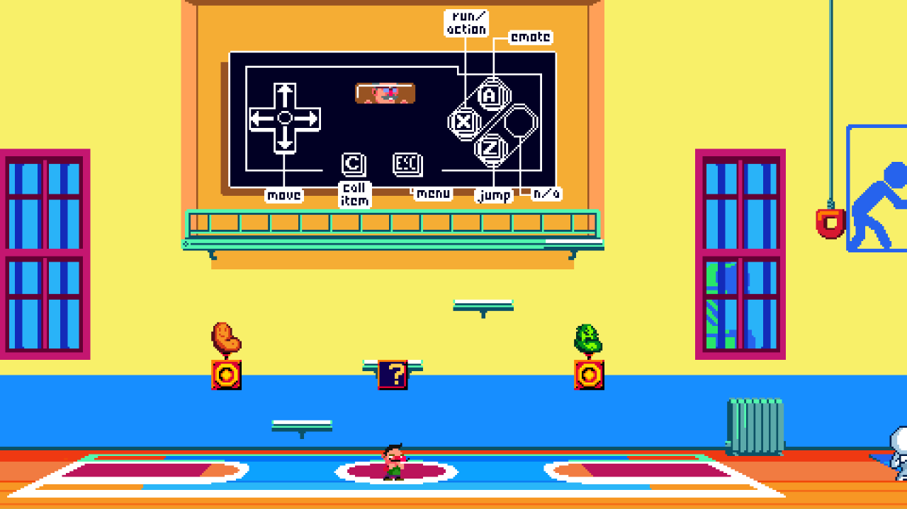

# Soviet Jump Game — Patch

A client-side patch that revives **Soviet Jump Game** (Steam AppID `1072710`, by
Fantastic Passion / Game Grumps) after its live services were shut down.

The game logs in through a chain that is now dead:

```
Steam  ──►  PlayFab (LoginWithSteam)  ──►  api.fantasticpassion.games/authenticate
```

PlayFab now answers `This request is not allowed due to API usage limits for the
title.`, the custom backend domain no longer exists, and the client sits forever on
the "authentication" screen.

This patch (a **BepInEx 5 / Harmony** plugin) short-circuits that dead gate so the
game reaches the main menu, and can point the client at a self-hosted server
(see the companion repo `soviet-jump-game-server`).

## Status

- ✅ Past the dead authentication screen → main menu
- ✅ **Playable offline**: `PRACTICE` starts the game's own local Bolt server
  (`BoltLauncher.StartServer(UdpEndPoint.Any, "Soviet Jump Game Tutorial")`)
- 🚧 Online-style play (Matchmaking) needs the companion server




## How it works

The plugin (`plugin/src/`) makes three small changes:

1. **Skips the dead auth flow** — harmony-prefixes `EPB.Networking.Authentication.CheckForAuth`
   so the failing Steam→PlayFab login never runs (it still brings Steam up, which the
   menu needs), and `ForceUpdatePlayFab.AuthenticationRoutine` so the menu gate
   (`ForceUpdatePlayFab.Initialized`) is satisfied instead of blocking forever.
2. **Injects a local session** — builds a synthetic `PlayFabAccount` + `TitleData` so the
   game believes it logged in (no network access).
3. **Stubs the in-game player's PlayFab customization fetch** so spawning the local
   player doesn't abort.

It also forces `ClientPermission.IsDeveloper = true` (unlocks the in-game dev console)
and can redirect the custom backend URL (`Server.ApiBaseUrl`) to a self-hosted server.

## Install

Requires the retail game files (bring your own, legally obtained copy).

```bash
# 1. Fetch BepInEx 5 x64 (or let install.sh do it)
./install/fetch-bepinex.sh "/path/to/Soviet Jump Game"

# 2. Build + install the plugin
./install/install.sh "/path/to/Soviet Jump Game"
```

Then launch the game normally through Steam. On **Steam/Proton (Linux)** set the
launch options to:

```
WINEDLLOVERRIDES="winhttp=n,b" %command%
```

To remove it: `./install/uninstall.sh "/path/to/Soviet Jump Game" [--with-bepinex]`.

## Configuration

Created on first run at `BepInEx/config/games.gfi.sjg.patch.cfg`:

| Key | Default | Meaning |
| --- | --- | --- |
| `OfflineMode` | `true` | Short-circuit the dead auth and run a local session. |
| `ForceDeveloper` | `true` | Force `ClientPermission.IsDeveloper = true`. |
| `ApiBaseUrl` | *(empty)* | Base URL of a self-hosted server, e.g. `http://127.0.0.1:8080/`. Empty = pure offline. |

## Build

The plugin is plain C# compiled with Mono's `mcs` (no Unity/dotnet SDK needed):

```bash
./plugin/build.sh "/path/to/Soviet Jump Game"
# -> dist/SjgPatch.dll
```

## Layout

```
plugin/src/      C# plugin sources
plugin/build.sh  builds dist/SjgPatch.dll with mcs
install/         install / uninstall / fetch-bepinex scripts
dist/            built SjgPatch.dll
docs/            screenshots
```

## Legal / disclaimer

Reverse-engineered purely for interoperability and preservation, with the
developer's permission, using a legally purchased copy. No copyrighted game
assets are included in this repository — you must own the game.

## License

MIT — see [LICENSE](LICENSE).
