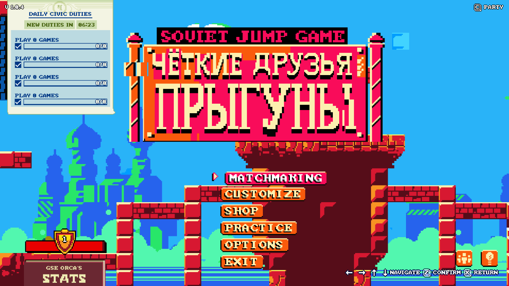

# Soviet Jump Game — Patch

A client-side patch that revives **Soviet Jump Game** (Steam AppID `1072710`, by
Fantastic Passion / Game Grumps) after its live services were shut down.

The game's login chain (`Steam → PlayFab → api.fantasticpassion.games`) is dead, so the
client hangs forever on the "authentication" screen. This patch — a **BepInEx 5 /
Harmony** plugin — short-circuits that gate so the game reaches the main menu, plays
offline (**Practice**), hosts a **local match with bots**, and **joins servers** from the
companion backend [`soviet-jump-game-server`](../soviet-jump-game-server).

Works on **Windows** and **Linux (Steam Proton)**.

## Install (one click — nothing else to install)

1. Download `sjg-patch-*.zip` from the [releases page](../../releases).
2. Unzip it anywhere, then:
   - **Windows** — double-click **`Install.bat`**.
   - **Linux / Steam Proton** — run **`./install.sh`**, then set the game's Steam
     Launch Options to `WINEDLLOVERRIDES="winhttp=n,b" %command%`.
3. Launch the game through Steam.

BepInEx is bundled, so no downloads and no extra software are needed. The installer asks
which **server** to use — press **Enter** for the default, `sjg.dnd.wtf`.

**Already have BepInEx?** Skip the installer and drop **`SjgPatch.dll`** into
`<game>/BepInEx/plugins/`.

## Controls

| Input | Action |
| --- | --- |
| `PRACTICE` | Play the tutorial offline (always works) |
| `MATCHMAKING` / **F8** | Host a local match on a real map with bots |
| **F6** | Join the server set in `Server.DirectConnectAddress` |

> **Note:** the game's own **Rooms** (private match / room code) and **server/region
> selection** menu entries do **not** work — they still call the shut-down live services.
> Use `PRACTICE`, `MATCHMAKING` (`F8`) or `F6` instead.

## Documentation

Full documentation lives in the **[wiki](https://github.com/gfisher1/soviet-jump-game-patch/wiki)**:

| Page | Contents |
| --- | --- |
| [Installation](https://github.com/gfisher1/soviet-jump-game-patch/wiki/Installation) | Release bundle, git checkout, BepInEx note, uninstall |
| [Configuration](https://github.com/gfisher1/soviet-jump-game-patch/wiki/Configuration) | Every config key, with an example file |
| [How It Works](https://github.com/gfisher1/soviet-jump-game-patch/wiki/How-It-Works) | The Harmony patches, in detail |
| [Building](https://github.com/gfisher1/soviet-jump-game-patch/wiki/Building) | Rebuild `SjgPatch.dll` from source |
| [Troubleshooting](https://github.com/gfisher1/soviet-jump-game-patch/wiki/Troubleshooting) | Common problems and fixes |

## Legal / disclaimer

Reverse-engineered for interoperability and preservation, with the developer's
permission, using a legally purchased copy. No copyrighted game assets are included —
you must own the game.

## License

MIT — see [LICENSE](LICENSE).
